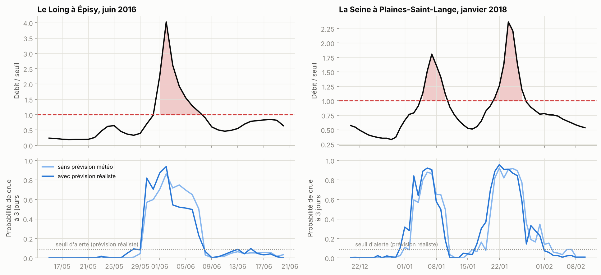
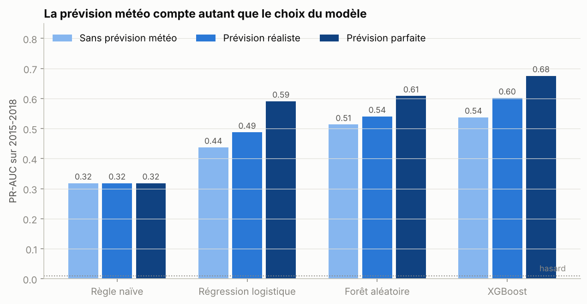
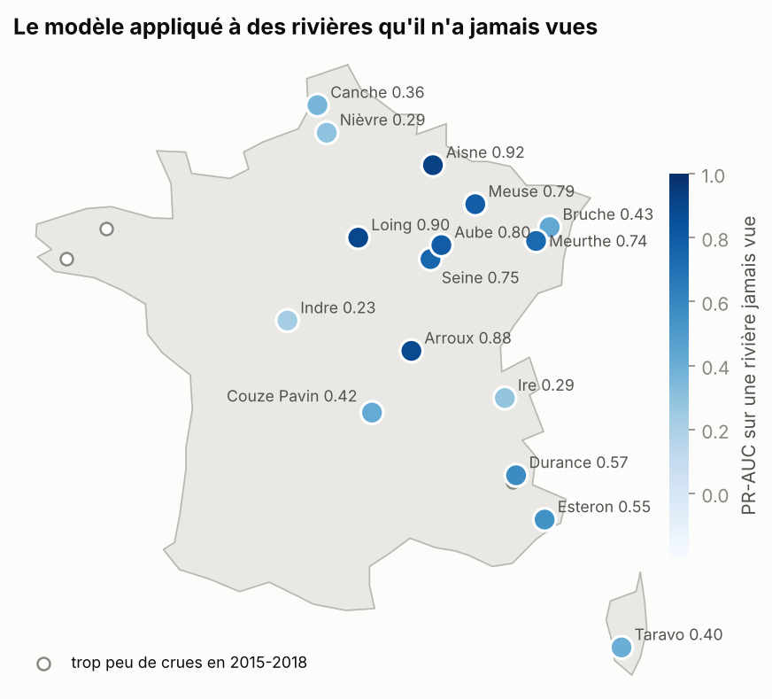

# Prévoir les crues en France : cette rivière va-t-elle déborder dans les 3 prochains jours ?

Les inondations sont le premier risque naturel en France. Ce projet construit un **système d'alerte précoce** par machine learning : chaque soir, à partir de la pluie, de la température et du débit observés, il estime la probabilité qu'une rivière dépasse son **niveau de crue** dans les 3 jours suivants.

Il s'appuie sur **20 ans de données réelles** (1999-2018) pour **19 rivières françaises**, de la Bretagne à la Corse, extraites de la base de recherche **CAMELS-FR** de l'INRAE (pluie Météo-France, débits du réseau national Hydroportail).

👉 Tout est dans le notebook : [`notebooks/prevision_crues.ipynb`](notebooks/prevision_crues.ipynb)

<p align="center">
  
  <br><em>La crue historique du Loing (juin 2016, Nemours) et la crue de la Seine (janvier 2018), vues par le modèle. Ces années n'ont jamais été vues pendant l'apprentissage.</em>
</p>

## Résultats

*Période de test : 2015-2018, jamais utilisée pour entraîner ni régler les modèles. Environ 1 % des jours sont suivis d'une crue.*

**PR-AUC** (aire sous la courbe précision-rappel, la mesure adaptée aux événements rares ; un tirage au hasard vaut 0,01) :

| Modèle | Sans prévision météo | Prévision météo réaliste | Prévision parfaite |
|---|---|---|---|
| Règle naïve (« la rivière est déjà haute ») | 0,32 | 0,32 | 0,32 |
| Régression logistique | 0,44 | 0,49 | 0,59 |
| Forêt aléatoire | 0,51 | 0,54 | 0,61 |
| **XGBoost** | **0,54** | **0,60** | **0,68** |

**Ce qu'un service de secours verrait** (XGBoost, prévision réaliste, 61 épisodes de crue sur 2015-2018) :

| Indicateur | Valeur |
|---|---|
| Crues annoncées à l'avance | **79 %** (56 % sans prévision météo) |
| Avance moyenne quand la crue est annoncée | **2,4 jours** |
| Jours d'alerte par station et par an | environ 6 |
| PR-AUC médiane sur une rivière **jamais vue** à l'entraînement | 0,56 (0,61 si la rivière est connue) |

Points clés :
- Le machine learning fait **beaucoup mieux que la règle naïve**, car il combine l'état de la rivière, la pluie récente, la nature du bassin et la saison.
- **La prévision météo compte autant que le choix de l'algorithme** : même très imparfaite, elle fait passer de 56 % à 79 % de crues annoncées.
- Le modèle **se transpose à des rivières qu'il n'a jamais vues** avec une perte modérée : il pourrait servir sur des cours d'eau peu suivis.
- L'information la plus utile est le **débit actuel** (une rivière déjà haute déborde vite), puis la pluie tombée et les caractéristiques du bassin.

<p align="center">
  
</p>

## Démarche

1. **Données** : 19 bassins versants très variés (plaines du Bassin parisien, Bretagne, Vosges, Alpes, Méditerranée, Corse), une valeur par jour de 1999 à 2018 : pluie, température, évapotranspiration et débit.
2. **Définition d'une crue** : le débit dépasse la **crue biennale** de la station (le débit atteint en moyenne une année sur deux), calculée uniquement sur la période d'apprentissage.
3. **Exploration** : deux crues réelles décortiquées et la **saisonnalité** des crues (hiver en plaine, fonte des neiges en mai-juin dans les Alpes, pluies d'automne en Méditerranée).
4. **Variables** (27, toutes calculées avec l'information connue le soir même) : cumuls de pluie sur 1 à 30 jours, bilan hydrique des sols, **petit modèle de fonte de neige** (degré-jour), débit actuel et sa tendance, saison, taille et altitude du bassin, et pluie prévue sur 3 jours. Le débit est divisé par le seuil de crue pour qu'**un seul modèle** apprenne sur toutes les rivières.
5. **Découpage chronologique** : apprentissage 1999-2010, validation 2011-2014, test 2015-2018.
6. **Modèles** : règle naïve, régression logistique, forêt aléatoire, XGBoost (arrêt anticipé sur la validation).
7. **Trois scénarios météo** : sans prévision, prévision réaliste (pluie future dégradée par une forte erreur aléatoire) et prévision parfaite (plafond théorique).
8. **Seuil d'alerte** choisi sur la validation en maximisant le **F2-score** : rater une crue coûte plus cher qu'une fausse alerte.
9. **Évaluation** : PR-AUC, POD / FAR / CSI (les scores des prévisionnistes), **évaluation par épisode** (crue annoncée ou non, avec combien de jours d'avance), importance des familles de variables par permutation, et **validation « une rivière laissée de côté »**.

<p align="center">
  
</p>

## Lancer le projet

```bash
git clone https://github.com/<ton-pseudo>/prevision-crues-france.git
cd prevision-crues-france
python -m venv .venv && source .venv/bin/activate   # Windows : .venv\Scripts\activate
pip install -r requirements.txt
jupyter notebook notebooks/prevision_crues.ipynb
```

Les données sont incluses dans `data/` (6 Mo) : aucun téléchargement ni clé d'API. Exécution complète : environ 2 minutes sur un ordinateur portable, sans GPU.

**Sur Google Colab** : `!git clone https://github.com/<ton-pseudo>/prevision-crues-france.git` puis `%cd prevision-crues-france` et ouvre le notebook (toutes les bibliothèques sont déjà installées sur Colab).

Tests : `python -m pytest` (vérifie notamment qu'**aucune variable n'utilise d'information future**).

## Structure

```
prevision-crues-france/
├── notebooks/prevision_crues.ipynb   # l'analyse complète, commentée
├── src/
│   ├── donnees.py      # chargement, seuil de crue biennale, découpage, épisodes
│   ├── variables.py    # variables explicatives, modèle de neige, cible, prévision bruitée
│   ├── modeles.py      # règle naïve, régression logistique, forêt aléatoire, XGBoost, seuil d'alerte
│   ├── evaluation.py   # PR-AUC, POD/FAR/CSI, évaluation par épisode, importance par famille
│   ├── carte.py        # fond de carte simplifié de la France
│   └── graphiques.py   # style des figures
├── data/               # données CAMELS-FR (CSV) et leur description
├── figures/            # graphiques générés par le notebook
├── resultats/          # tableaux de scores (CSV) générés par le notebook
├── scripts/            # génération du notebook, extraction des données
└── tests/              # tests unitaires (pytest)
```

## Limites et pistes

- « En crue » signifie ici « au-dessus de la crue biennale », pas « dégâts constatés ». Croiser avec les arrêtés de catastrophe naturelle (base GASPAR) permettrait de prédire directement les communes sinistrées.
- Le scénario « prévision réaliste » simule l'erreur d'une prévision ; utiliser de vraies prévisions archivées (AROME, ECMWF) donnerait une mesure exacte du gain.
- Le pas de temps journalier est trop grossier pour les crues éclair méditerranéennes ; des données horaires (API Hub'Eau) seraient l'étape suivante.
- La base CAMELS-FR complète compte plus de 650 bassins : l'utiliser rendrait le modèle plus robuste sur les rivières non suivies.

## Source des données

Delaigue, O., Guimarães, G. M., Brigode, P., Génot, B., Perrin, C., Andréassian, V. (2024). *CAMELS-FR dataset*. Recherche Data Gouv, [doi:10.57745/WH7FJR](https://doi.org/10.57745/WH7FJR). Extrait diffusé dans le paquet [`airGRdatasets`](https://cran.r-project.org/package=airGRdatasets) (INRAE), licence CC BY 4.0. Météo : réanalyse SAFRAN (Météo-France). Débits : SCHAPI / Hydroportail.
